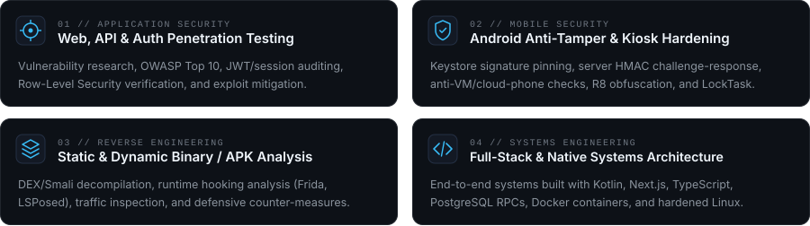
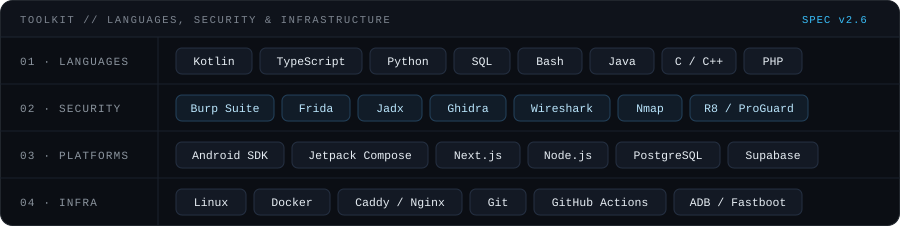

<p align="center">
  
</p>

<br/>

```text
poch1@sec-node:~$ cat about.txt
  handle     : poch1 (@bluepochi11)
  role       : Cybersecurity Researcher & Software Engineer
  focus      : Application Security, Android Hardening, Reverse Engineering, Full-Stack Systems
  ethos      : Offensive mindset, defensive architecture, zero trust on client-side checks.
```

---

### Core Domains

<p align="center">
  
</p>

---

### Technical Toolkit

<p align="center">
  
</p>

---

### Engineering & Security Methodology

| Area | Practices & Controls |
| :--- | :--- |
| **Android Anti-Modding** | Signing certificate SHA-256 pinning, server-side HMAC challenge-response, R8 aggressive class repackaging, Frida / Xposed / LSPosed runtime detection, anti-VM & cloud-phone fingerprinting. |
| **Kiosk & Runtime Integrity** | Foreground watchdog persistence, `LockTask` / Device Owner policy enforcement, anti-overlay & screen-recording detection, server-enforced version gating with SHA-256 verified auto-updates. |
| **Web & API Hardening** | Strict Content-Security-Policy (nonce + `strict-dynamic`), PostgreSQL Row-Level Security (RLS), `SECURITY DEFINER` RPC boundaries, rate-limiting & tamper-evident audit logging. |
| **Security Research** | Static/dynamic APK analysis, HTTP/API interception, authentication & authorization flow testing, secure architecture review. |

---

### Featured Public Release

| Project | Summary | Stack |
| :--- | :--- | :--- |
| [**smpn11-cbt-release**](https://github.com/bluepochi11/smpn11-cbt-release) | Hardened Android CBT exam client with 7-layer anti-modding, anti-VM/cloud-phone detection, always-alive power/kiosk shield, and server-enforced auto-updater. | `Kotlin` · `Jetpack Compose` · `R8` · `PostgreSQL RPC` |

---

<p align="center">
  
</p>
